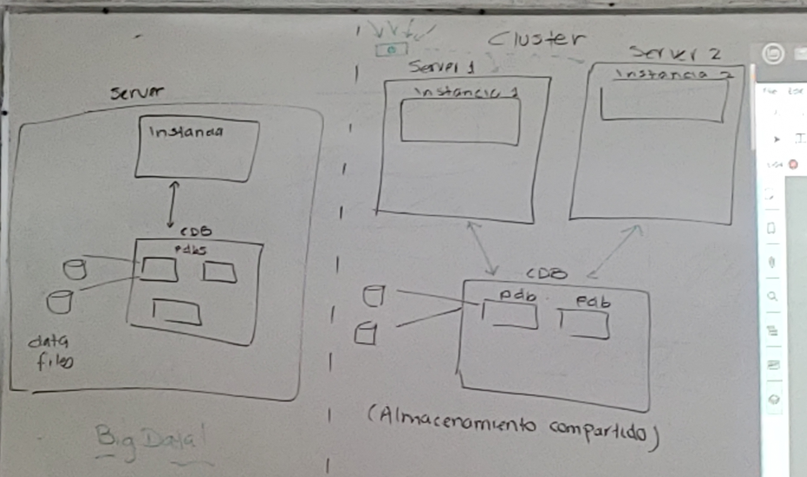
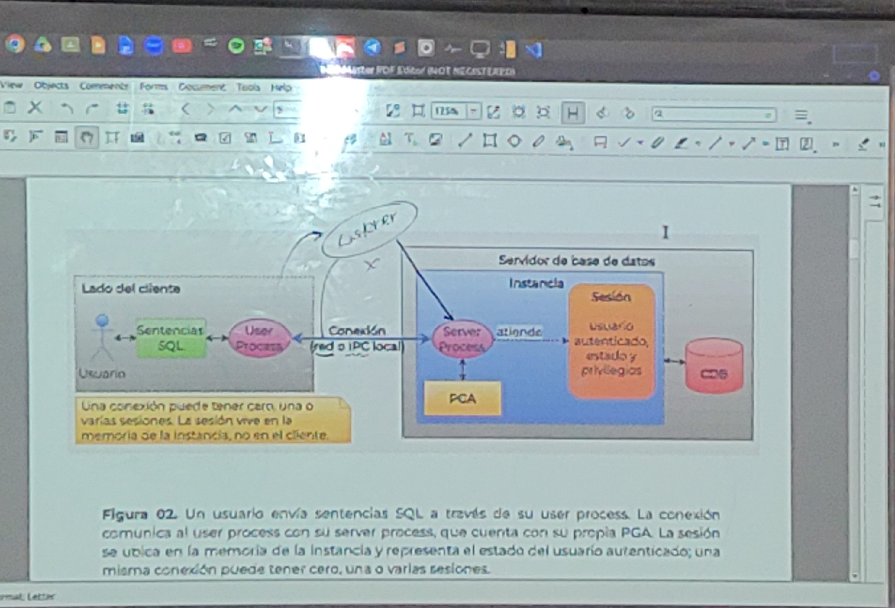
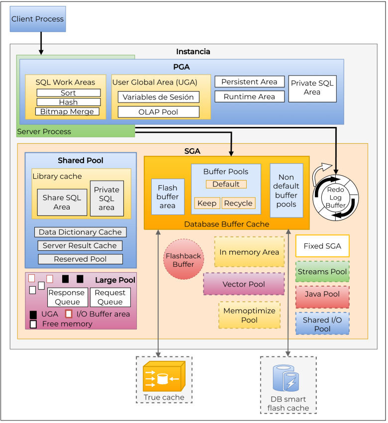
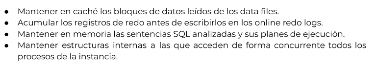
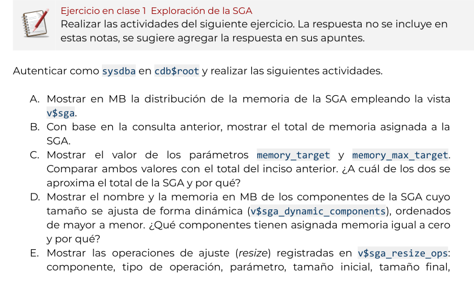

# TEMA 4

## 30 sep 2026

##### Áreas de Memoria

- SGA: System Global Area

- PGA: Program Global Area -> para server processes <-> los que atienden a los usuarios ( conexiones )

- MGA: Managed Global Area

#### Arquitecturas actuales

- Multitenant: Una Instancia de BD con una CDB y dentro de la CDB varas PDB's

- RAC ( Real Application Cluster ): "Almacenamieto compartido"" -> los servers Comparten la CDB ( es una instancia de oracle especial )



#### Conexiones, sesiones, user processes, server processes

- User Processes: el el cliente del usuario ( sqlplus, vscode, sqldeveloper )

- Server processes: La instancia de la BD lanza uno por cada conexión: 10 usuarios conectados -> 10 server processes para atenderlos, no siempre **Modo Compartido**

- Sesion: Un area de memoria usada por el **server processes** para atender las solicitudes SQL

- Listener ( lee tnsnames ): permite que el **user processes** un usuario remoto establesca una conexión con el **server processes** que atiende sus solicitures



#### Sesiones



- Areas punteadas: Son **opcionales**

- **pool**: Area de memoria que guarda componentes reutilizablres

#### Componentes de la SGA

Principales funciones de la SGA



#### Ejercicio de clase



documento del ejercicio

[en dirve](https://docs.google.com/document/d/11jnctHqWVpACCY5deRz0jHyqn8qvTJ2R0ZM5UX-rrR4/edit?tab=t.0)

scrip del ejecrcicio

```sql
-- inciso A
select name, trunc(value / 1024 / 1024, 2) as value_mb
from v$sga;
-- inciso B
select trunc(sum(value) / 1024 / 1024, 2) as total_sga_mb
from v$sga;

-- inciso C
select name, display_value
from v$parameter
where name in ('memory_target', 'memory_max_target');

-- inciso D

select component, trunc(current_size / 1024 / 1024, 2) as current_size_mb
from v$sga_dynamic_components
order by current_size desc;


-- Inciso F
select component, oper_type, parameter,
  trunc(initial_size / 1024 / 1024, 2) as initial_mb,
  trunc(final_size / 1024 / 1024, 2) as final_mb,
  trunc((final_size - initial_size) / 1024 / 1024, 2) as incremento_mb,
  status,
  to_char(end_time, 'yyyy-mm-dd hh24:mi:ss') as end_time
from v$sga_resize_ops
order by end_time;

-- G memoria libre
select trunc(current_size / 1024 / 1024, 2) as free_mb
from v$sga_dynamic_free_memory;

-- h estadisticas de la SGA
select name, trunc(bytes / 1024 / 1024, 2) as mb, resizeable
from v$sgainfo;
```


## 07 octubre

**Escrituras de Logwriter**

- commit

- despues de 3 segundos

- lleno a $\frac{1}{3}$

- Cuando DB_WRITER le gana a escribir -> obliga a LOG_WITER a sincronizar con redologs      **Un buffer sucio primer debe estar en redologs antes que en datafiles** **WRITE_AHEAD PROTOCOL**


**REDO**: CAmbios nuevo

**UNDO** Cambios viejos

alter ystem checkpoint -> de dbBuffer a datafiles

## Ejercicio de clase undo y redo

A) 


# Shared Pool

**Library cache**: Código Parseado

SQL inyection

```php
sql="insert into usuario (id, nombre, menbresia) values ("+ $curren_id + "," + $current_nombre + "," + $current_menbresisa +");"
```

Tampoco es eficiente hacerlo uno por uno

**SQL Parametrizado**

```plsql
insert into ususrio (id, nombre, membresia)
values(:1, :2, :3),

```

Lenguajes pueden acer sql parametroizado

```java
values (?,?,?)
```
